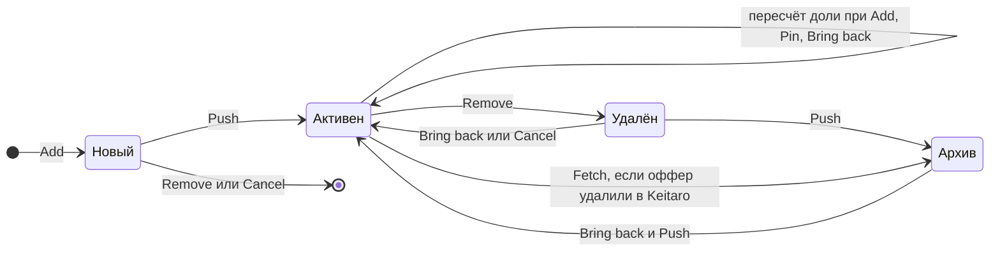

# Keitaro wrapper

[](https://github.com/DiMiRka/etolegko-keitaro/actions/workflows/ci.yml)

Обёртка над [Keitaro](https://keitaro.io) Admin API: создание кампаний по шаблону и редактор офферов в потоках с отложенной публикацией

Стек: FastAPI, SQLAlchemy 2.0 (async), Alembic, PostgreSQL, httpx, Jinja2 + jQuery + Select2, тесты на `unittest`

## Содержание

- [Возможности](#возможности)
- [Запуск](#запуск)
- [Вход в сервис](#вход-в-сервис)
- [Миграции](#миграции)
- [Тесты](#тесты)
- [Как устроен редактор потоков](#как-устроен-редактор-потоков)
- [Настройки](#настройки)
- [Структура проекта](#структура-проекта)
- [Ограничения тестового трекера](#ограничения-тестового-трекера)

## Возможности

**По заданию**

- **Создание кампании.** По названию, гео и офферу создаётся кампания с двумя потоками: поток 1 отправляет трафик из указанной страны на `https://google.com`, поток 2 отправляет всех остальных на выбранный оффер. Префикс `test_mironov_` подставляется сам, ротация «по позиции», CPC 0 USD из параметра cost.
- **Редактор офферов в потоках.** «Загрузить потоки из Keitaro» (Fetch), добавление оффера с поиском, «Удалить» (Remove) с архивом и «Вернуть» (Bring back), закрепление доли (пин), «Отменить» (Cancel) и «Опубликовать в Keitaro» (Push). Веса пересчитываются сразу, а поток подсвечен жёлтым, пока изменения не опубликованы. Офферы, удалённые прямо в Keitaro, при следующей загрузке переходят в архив.

**Сверх задания**

- **Защита от конфликтов.** Перед публикацией поток сверяется с Keitaro, и чужие изменения не перезаписываются без подтверждения.
- **Карточка кампании.** Ссылка для трафика, включение и выключение, вкладки «Общие / Затраты / Уникальность / Заметки», выбор домена, группы и источника из Keitaro, создание группы.
- **Статистика.** Клики, уникальные, боты, конверсии и доход за 7 дней по кампании, потокам и офферам.
- **Журнал изменений.** Кто, когда и что сделал, с долями до и после.
- **Раздел «Офферы».** Каталог со статистикой и список потоков, где стоит оффер.
- **Вход по логину и паролю.**

## Запуск

Нужен Docker с Compose v2.

1. Скопируйте пример настроек:

   ```powershell
   copy .env.example .env      # Linux/macOS: cp .env.example .env
   ```

2. Заполните в `.env`:

   ```env
   KEITARO_API_KEY=ключ_из_админки   # Keitaro → Профиль → API ключи
   SECRET_KEY=длинная_случайная_строка
   ADMIN_USERNAME=admin
   ADMIN_PASSWORD=пароль_от_8_символов
   ```

   `SECRET_KEY` можно сгенерировать так: `python -c "import secrets; print(secrets.token_urlsafe(32))"`.

3. Запустите:

   ```powershell
   docker compose up -d --build
   ```

Поднимутся PostgreSQL и приложение. При старте приложение само применяет миграции и создаёт первого пользователя из `ADMIN_USERNAME` и `ADMIN_PASSWORD`. Интерфейс откроется на http://localhost:8000, Swagger на http://localhost:8000/docs (тоже после входа).

Если порты 8000 или 5432 заняты:

```powershell
$env:APP_PORT=8080; $env:POSTGRES_PORT=5433; docker compose up -d --build
```

В Linux/macOS: `APP_PORT=8080 POSTGRES_PORT=5433 docker compose up -d --build`.

Логи и остановка:

```powershell
docker compose logs -f app
docker compose down        # данные базы сохраняются в volume pgdata
docker compose down -v     # удалить и данные
```

Этот вариант для локального запуска: порты открыты только на `127.0.0.1`. Для сервера есть отдельный [`docker-compose.prod.yml`](docker-compose.prod.yml): HTTPS через Caddy, база и приложение без открытых портов, ежедневные бэкапы. Инструкция по деплою в [DEPLOY.md](DEPLOY.md).

## Вход в сервис

Все страницы и API доступны только после входа. Без входа страницы перенаправляют на `/login` и после входа возвращают туда, откуда пришёл пользователь, а API отвечает `401`.

Ещё одного пользователя можно создать или сменить ему пароль так (пароль спросит в терминале):

```powershell
docker compose exec app python -m app.cli create-user ivan
docker compose exec app python -m app.cli set-password ivan
```

Пароли хранятся в виде хеша scrypt с солью. Сессия хранится в cookie, подписанной HMAC-SHA256 ключом `SECRET_KEY` (HttpOnly, SameSite=Lax).

## Миграции

Миграции Alembic лежат в [`migrations/versions`](migrations/versions) и применяются автоматически при каждом старте контейнера (`alembic upgrade head`). Вручную:

```powershell
docker compose exec app alembic current          # текущая версия схемы
docker compose exec app alembic history          # список миграций
docker compose exec app alembic downgrade -1     # откатить последнюю
docker compose exec app alembic upgrade head     # применить все
```

CI на каждый push прогоняет все миграции на PostgreSQL вверх, вниз и снова вверх.

## Тесты

Тестам не нужны ни сеть, ни ключ Keitaro: трекер подменяется фейковым клиентом, база берётся SQLite в памяти. Запуск в одноразовом контейнере:

```powershell
docker run --rm -v "${PWD}:/src:ro" -w /src python:3.12-slim sh -c "pip install -q -r requirements-dev.txt && python -m unittest discover -s tests && ruff check --no-cache ."
```

В Linux/macOS вместо `${PWD}` подставьте `$(pwd)`.

Те же проверки и сборку Docker-образа выполняет [GitHub Actions](.github/workflows/ci.yml).

## Как устроен редактор потоков

### Состояние оффера

У каждого оффера в потоке хранятся рабочие поля (`share`, `state`: `active` / `removed`) и снимок последней публикации (`published_share`, `published_state`). Поток жёлтый, если у какого-то оффера рабочие поля отличаются от снимка. Отдельного флага «изменён» нет, он вычисляется.



- **Новый:** оффера ещё не было в Keitaro.
- **Удалён:** оффер снят у нас, но в Keitaro пока есть.
- **Архив:** оффера нет в Keitaro, у нас он остаётся серым с кнопкой «Вернуть».

| Действие | Что происходит |
|---|---|
| **Fetch** | Потоки и доли берутся из Keitaro как есть. Оффер, которого больше нет в Keitaro, уходит в архив. Неопубликованные изменения сбрасываются, пины сохраняются. Поток без офферов (редирект с фильтром) сохраняется просто как поток, его содержимое не разбирается. |
| **Add / Remove / Bring back / Pin** | Меняют рабочие поля и пересчитывают веса. В Keitaro пока ничего не уходит. |
| **Cancel** | Новые офферы удаляются, остальным возвращаются доля и статус из снимка. |
| **Push** | В `PUT /streams/{id}` уходит список активных офферов с долями (Keitaro заменяет список целиком). После успеха снимок приравнивается к рабочим полям. |
| **Конфликт** | Перед Push поток перечитывается из Keitaro и сравнивается со снимком. Если офферы там изменили после загрузки, публикация останавливается (`409`) со списком изменений. Дальше можно загрузить потоки заново или опубликовать с перезаписью. |

### Пересчёт весов

- Закреплённые офферы сохраняют долю.
- Остаток `100 − сумма закреплённых` делится поровну между остальными активными. Проценты целые, лишние единицы достаются первым по порядку (34 / 33 / 33).
- Удалённые получают 0.
- Сумма активных всегда ровно 100. Если это невозможно (закреплённые больше 100 или закреплены все, но в сумме не 100), операция отклоняется с понятной ошибкой и ничего не меняет.

Keitaro сам сумму долей не проверяет (принимает и 99), поэтому проверка выполняется на нашей стороне.

## Настройки

Все переменные задаются в `.env`, пример лежит в [`.env.example`](.env.example).

| Переменная | По умолчанию | Назначение |
|---|---|---|
| `KEITARO_URL` | `https://tlgk.host` | адрес трекера |
| `KEITARO_API_KEY` | — | ключ Admin API |
| `SECRET_KEY` | случайный при старте | ключ подписи сессии; без него после перезапуска придётся войти заново |
| `ADMIN_USERNAME`, `ADMIN_PASSWORD` | — | первый пользователь, создаётся, если пользователей ещё нет |
| `COOKIE_SECURE` | `false` | `true`, если сервис открыт по https (в продовом compose включено) |
| `DOMAIN`, `POSTGRES_PASSWORD` | — | только для `docker-compose.prod.yml`: домен для сертификата и пароль базы |
| `BACKUP_INTERVAL_HOURS`, `BACKUP_KEEP_DAYS`, `BACKUP_PING_URL` | `24`, `14`, — | бэкапы в продовом compose |
| `CAMPAIGN_PREFIX` | `test_mironov_` | префикс имени новой кампании |
| `KEITARO_DOMAIN_ID`, `KEITARO_GROUP_ID`, `KEITARO_TRAFFIC_SOURCE_ID` | `1813`, `10332`, `836` | домен, группа и источник по умолчанию в форме создания |
| `KEITARO_TIMEZONE` | `Europe/Moscow` | часовой пояс статистики |

## Структура проекта

```
app/
  main.py         сборка приложения: проверка входа, обработчики ошибок
  cli.py          создание пользователей
  core/           настройки, база, ошибки, безопасность, кэш
  keitaro/        async-клиент Keitaro Admin API
  models/         таблицы: кампании, потоки и офферы, пользователи, журнал
  schemas/        схемы запросов и ответов API
  services/       бизнес-логика: потоки, веса, кампании, статистика, журнал
  api/            JSON API по разделам
  web/            страницы, вход, шаблоны и статика
migrations/       миграции Alembic
tests/            тесты
```

Зависимости идут в одну сторону: `api` и `web` → `services` → `models`, `keitaro`, `core`. Сервисы не зависят от FastAPI, поэтому логика тестируется напрямую.

## Ограничения тестового трекера

- **Офферы.** API-ключу доступен только один оффер, прав на создание офферов нет. Поэтому сценарий с несколькими офферами (3 → 4 по 25%) проверен тестами, а вживую проверен полный цикл на одном оффере.
- **Источники трафика.** Создавать их ключ не может (403), поэтому их можно только выбирать. Группы кампаний создавать можно.
- **Cloudflare.** Keitaro стоит за Cloudflare, который блокирует стандартный User-Agent Python-клиентов (ошибка 1010). Клиент отправляет свой `User-Agent`.
